# Org chart

As of Nov 18, 2026. Dotted line = unverified reporting.

```mermaid
flowchart TD
  owner["Tishan Perera · Owner"]
  amanda["Amanda · Chief of Staff & COO · Working"]
  chief_of_mailroom["Chief of Mailroom · Waiting · Parked"]
  head_of_gmail["Gmail · Head of Gmail · Working"]
  head_of_whatsapp["WhatsApp · Head of WhatsApp · Working"]
  chief_of_youtube["Chief of Youtube · Waiting · Parked"]
  script_writer["Script Writer · Waiting · Parked"]
  youtube_analyst["YouTube Analyst · Waiting · Parked"]
  ystudio["YStudio · Unverified"]
  chief_of_storage["Chief of Storage · Waiting · Parked"]
  chief_on_investments["Chief on Investments · Working"]
  chief_of_credit["Chief of Credit · Pending"]
  gold_fundamentals["Gold Fundamentals · Working"]
  rio["Rio · AI Systems Architect & Lead Developer · Waiting · Parked"]
  lex["Lex · Chief Design Engineer · Waiting · Parked"]
  os_tester["OS Tester · Waiting · Parked"]
  clay_avatar_artist["Clay Avatar Artist · Waiting · Parked"]
  linkedin_director["LinkedIn Department Director · Working"]
  linkedin_profile_branding["LinkedIn Profile & Branding Specialist · Working"]
  ai_finance_content["AI & Finance Content Specialist · Working"]
  career_acquisition["Career Acquisition & Networking Specialist · Working"]
  owner --> amanda
  amanda --> chief_of_mailroom
  chief_of_mailroom --> head_of_gmail
  chief_of_mailroom --> head_of_whatsapp
  amanda --> chief_of_youtube
  chief_of_youtube --> script_writer
  chief_of_youtube --> youtube_analyst
  chief_of_youtube -.-> ystudio
  amanda --> chief_of_storage
  amanda --> chief_on_investments
  amanda --> chief_of_credit
  amanda --> gold_fundamentals
  amanda --> rio
  amanda --> lex
  amanda --> os_tester
  amanda --> clay_avatar_artist
  amanda --> linkedin_director
  linkedin_director --> linkedin_profile_branding
  linkedin_director --> ai_finance_content
  linkedin_director --> career_acquisition
```

See [roster.yaml](roster.yaml) for the machine-readable version and [../agents/former-seats.md](../agents/former-seats.md) for seats that no longer exist.
