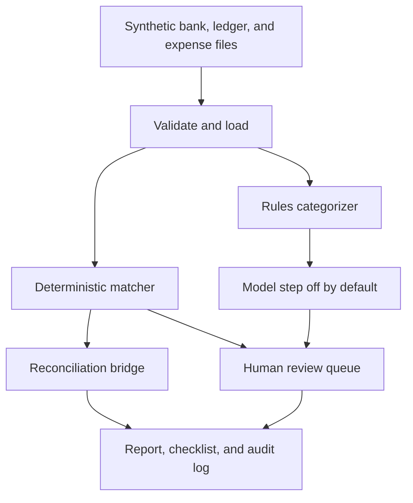

# Close and Reconciliation Assistant

Portfolio project for a finance and AI automation role. It runs a month-end
cash reconciliation and an expense-coding review for a fictional company,
Sample Harbor LLC. A person approves anything uncertain. The program does not
post journal entries.

This is not a product and it has not been used on a real close. The data is
synthetic. There are no account numbers and no client records.

## Problem

A cash close asks three questions. What cleared? What is still open because of
timing? What is on one side only, and does it need a journal entry? Real
statements make that harder: a check clears days later, a deposit hits the
bank as one batch, a reference is blank, an amount is off by a few dollars, or
the same draft appears twice.

Coding the related vendor bills has the same shape. Some descriptions are
obvious. Some conflict. Some are too vague to trust. A useful assistant
proposes a category with a confidence and a reason, and it leaves the weak
ones for a person.

## Approach

The default path is deterministic and has no model call.

1. Load a bank statement, a general-ledger cash account, and vendor expenses
   for one month. Every row must be labelled `SYNTHETIC`. The loader refuses
   any other label, and it refuses an 8-digit run so an account number cannot
   sit in a reference field unnoticed.
2. Match bank lines to ledger lines. Exact pairs clear first. Rule-based
   fuzzy checks run after that. Ambiguous candidates do not clear.
3. Build a reconciliation bridge. Every loaded line is cleared, suggested,
   flagged as a possible duplicate, or placed in one reconciling bucket. The
   unexplained difference must equal the opening book balance minus the
   opening bank balance. If that identity fails, the run stops and writes
   nothing.
4. Categorize expenses with keyword rules. Each suggestion has a confidence
   and a reason. Low-confidence, conflicting, and duplicate rows are marked
   for review. High-confidence rows are suggestions too.
5. Write a review file and an audit log. Approving a row records
   `approved_not_posted`. There is no posting step.

Positive amounts are cash in. Negative amounts are cash out.

Matching rules, in order:

| Order | Rule | Result when the pair is unique |
| --- | --- | --- |
| 1 | Same amount, same date, same reference | Cleared match, confidence 1.00 |
| 2 | Same amount and reference, dates 1 to 5 days apart | Cleared timing match, confidence 0.95 |
| 3 | Same amount inside the date window, and at least one reference is blank | Suggestion, confidence 0.70 |
| 4 | Same reference, date window, amount difference within 10.00 and 2 percent | Suggestion, confidence 0.62 |
| 5 | One bank line equals a unique sum of 2 or 3 ledger lines in the window | Suggestion, confidence 0.58 |

If more than one pairing fits a rule, nothing clears. A same-side repeat with
the same amount and reference inside two days is held out as a possible
duplicate, so one keeper can still match.

The optional model step sits behind `CategorySuggester`. It runs only when
`Settings.enable_llm` is true and the caller injects an in-process function.
The default is false. An environment variable cannot turn it on. The command
line refuses `--enable-llm`. This project does not include a network client,
an SDK, or a credential lookup. A model suggestion still carries a confidence
and a reason, still goes to review when confidence is under 0.75, and still
does not post.

## Architecture



| Path | Role |
| --- | --- |
| `close_recon/load.py` | Read the month and reject anything that is not labelled synthetic |
| `close_recon/match.py` | Exact match, then fuzzy rules, duplicates, and group suggestions |
| `close_recon/reconcile.py` | Bank-to-book bridge and the tie-out check |
| `close_recon/categorize.py` | Keyword rules and the optional injected suggester |
| `close_recon/review.py` | Review queue and approve or reject, without posting |
| `close_recon/audit.py` | One row for every match, flag, coding decision, and reviewer action |
| `close_recon/report.py` | Markdown report, checklist, and CSV files |
| `data/` | Fictional March 2026 inputs |
| `examples/sample-output/` | Output of the command below, checked by a test |

## How to run

From the repository root, with Python 3.11 or newer. No packages to install,
no API key, and no network:

```bash
python3 -B projects/close-recon-assistant/run.py
```

That writes `projects/close-recon-assistant/output/`. The directory is
gitignored. The committed sample was produced by the same command with
`--output projects/close-recon-assistant/examples/sample-output`. The default
as-of timestamp is `2026-04-02T15:00:00+00:00`, so a fresh run matches those
files.

Tests:

```bash
cd projects/close-recon-assistant
python3 -B -m unittest discover -s tests -v
```

A reviewer decision file uses `examples/decisions.template.csv`. Columns are
`item_id`, `decision`, `reviewer`, and `note`. `decision` is `approve` or
`reject`. `SIGN-OFF` is the checklist sign-off. Example ids from this month
are `MATCH-M-12`, `DUP-bank-B-11`, `JE-R-05`, and `CAT-E-10`.

```bash
python3 -B projects/close-recon-assistant/run.py --decisions path/to/decisions.csv
```

## Sample output

This is the command output for the fictional March 2026 month:

```text
Close & Reconciliation Assistant
Data origin: SYNTHETIC
Entity: Sample Harbor LLC (fictional)
Period: 2026-03
Bank balance: 18853.94 USD
Book balance: 20557.67 USD
Adjusted bank: 20468.39 USD
Adjusted book: 20468.39 USD
Unexplained difference: 0.00 USD
Matched groups: 10
Suggested groups: 3
Reconciling items: 8
Review queue: 19 pending
Journal entries posted: 0
LLM enabled: false
Overall status: in progress
```

Summary from `examples/sample-output/reconciliation_report.md`:

| Line | Amount |
| --- | --- |
| Bank beginning balance | 20,000.00 |
| Book beginning balance | 20,000.00 |
| Bank balance | 18,853.94 |
| Book balance | 20,557.67 |
| Adjusted bank balance | 20,468.39 |
| Adjusted book balance | 20,468.39 |
| Unexplained difference | 0.00 |
| Proposed unposted book adjustments | -89.28 |
| Journal entries posted | 0 |

The bridge explains the gap with a 2,150.00 deposit in transit, 955.55 of
outstanding payments, a 420.00 suspected bank duplicate, a 25.00 fee, 4.12 of
interest, an unidentified 63.40 card purchase, and a 5.00 proposed book
correction on check CHK-1006. The vendor bill for that check matches the book
amount, not the bank amount. None of those proposed entries are posted.

Selected rows from that report. M-01 through M-10 are cleared, and M-11
through M-13 stay suggestions. The full 13-row table is in the report file.

| Match | Status | Rule | Confidence | Bank lines | Book lines | Bank amount | Book amount |
| --- | --- | --- | --- | --- | --- | --- | --- |
| M-01 | matched | exact | 1.00 | B-01 | G-01 | 4,500.00 | 4,500.00 |
| M-09 | matched | amount_ref_date_window | 0.95 | B-07 | G-07 | -875.00 | -875.00 |
| M-11 | suggested | amount_date_missing_ref | 0.70 | B-14 | G-14 | -512.00 | -512.00 |
| M-12 | suggested | amount_tolerance_exact_ref | 0.62 | B-09 | G-12 | -1,255.00 | -1,250.00 |
| M-13 | suggested | group_sum | 0.58 | B-16 | G-16, G-17 | 1,500.00 | 1,500.00 |

Checklist from `examples/sample-output/close_checklist.md`:

| Step | Status | Detail |
| --- | --- | --- |
| Load bank statement | Complete | 17 synthetic lines for 2026-03. |
| Load general ledger cash | Complete | 17 synthetic lines on 1000-CASH-OPERATING. |
| Load vendor expenses | Complete | 12 synthetic expense lines. |
| Match bank lines to the ledger | Complete | 10 cleared, 3 suggested, 1 possible duplicate. |
| Prepare the reconciliation | Complete | Unexplained difference 0.00 USD. That equals the opening difference. |
| Review suggested matches | Open | 3 of 3 still pending. |
| Review duplicate and ambiguity exceptions | Open | 1 of 1 still pending. |
| Approve proposed book entries | Open | 3 of 3 still pending. |
| Review expense categories | Open | 12 category rows still pending, including 4 rows flagged for review. None are posted. |
| Confirm the unexplained difference | Complete | 0.00 USD. |
| Reviewer sign-off | Open | No SIGN-OFF approval is on file. |
| Post journal entries | Not available | This tool does not post. Approved items stay approved_not_posted. |

An unexplained difference of 0.00 means the openings agree and every line was
classified. It does not mean a reviewer has approved the open items. The
review file still has 19 pending rows. Four expenses are flagged by the rules:
vague consulting wording, a lunch-versus-supplies conflict, an unknown
vendor, and a duplicate insurance bill.

## What is working

- Synthetic one-month inputs with timing differences, a duplicate draft, an
  amount typo, a missing reference, a batch deposit, bank fee and interest,
  and an unidentified card purchase.
- Exact and fuzzy matching, with ambiguous candidates left unmatched.
- A reconciliation statement: book balance, bank balance, reconciling items,
  and unexplained difference.
- Expense categories with confidence and reason. Low-confidence items go to
  the review queue. Nothing auto-posts.
- An optional model interface that is off by default and is not called in
  tests or CI.
- A review file, an audit log of match and coding decisions, and a close
  checklist.
- Applying a reviewer file. Approved rows stay `approved_not_posted`.

## What is planned

- More than one cash account, and currencies other than USD.
- Partial payments and instalments.
- A three-way match that is its own result. Today a vendor bill is only a
  note on an amount difference.
- Letting a reviewer unmatch a cleared exact pair from the review file.
- A real model adapter behind the existing interface, still with no auto-post.
- An export of approved journal lines for an ERP import. This tool would
  still not post them.
- A reviewer screen, instead of a CSV.
- Flux checks against the prior month.

## Limitations

- One fictional month, one cash account, US dollars. Sample Harbor LLC is not
  a real entity.
- Keyword rules are brittle. They are a baseline a person maintains, not a
  judgment about the business.
- The fuzzy rules miss partial payments, many-to-many batches above three
  lines, and foreign currency. Group suggestions stop above eight open lines,
  and overlapping groups follow bank line id order.
- Duplicate detection is a two-day signature on amount and reference. It is
  not an anomaly model. A repeated monthly charge outside that window is left
  alone.
- A zero unexplained difference is a tie-out of the classification. Proposed
  fees, interest, the card purchase, and the five-dollar correction still
  need a person, and they are not posted.
- Exact matches are logged and reported. This version cannot reject one from
  the review file.
- There is no ERP connection and no live model. CI does not need a key or
  the network for this project.

## Tests

The suite covers the match rules, duplicate and ambiguity cases, group
suggestions, the tie-out identity on random populations, the sample-month
totals, low-confidence routing, and the fact that the model step is off by
default. One test fails if `examples/sample-output/` drifts from a fresh run.
Another reads the package and fails if a network client is imported.
